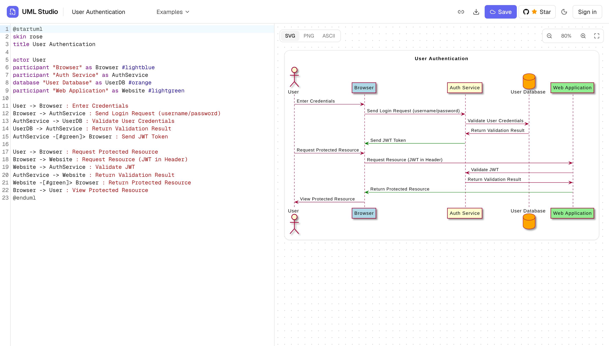

<div align="center">

# UML Studio

**Free, open-source diagram studio with AI. PlantUML, Mermaid, text-to-diagram and photo-to-diagram.**
Write code, describe it in plain English, or snap a whiteboard photo, and get a clean, editable diagram.

**[▶ Try it live](https://umlstudio.vercel.app)**

[](LICENSE)
[](https://nextjs.org)
[](CONTRIBUTING.md)
[](https://github.com/tahmidbintaslim/umlstudio)

<picture>
  <source media="(prefers-color-scheme: dark)" srcset="docs/screenshot-dark.png">
  
</picture>

</div>

## Why UML Studio?

Students and developers juggle draw.io, Excalidraw, Miro, Mermaid Live and PlantText, and each covers only part of the job.
UML Studio puts **diagrams-as-code, AI and export in one free, open-source place.**

- **Three ways in.** Write PlantUML or Mermaid, **describe** the diagram in plain English, or **upload a photo** of a whiteboard, hand sketch or screenshot. AI turns it into clean, editable code.
- **Fix with AI.** Syntax error? One click repairs it.
- **Two languages, one editor.** PlantUML *and* Mermaid, detected automatically, with 16 templates.
- **Live preview** as you type, resizable split view, zoom and fit, dark mode, mobile layout.
- **Export** SVG, PNG, ASCII art, `.puml` / `.mmd`.
- **Share links** that hold the whole diagram in the URL, with nothing stored server-side.
- **Cloud library.** Sign in (GitHub, Google or email) and save every diagram.
- **Safe preview.** Diagrams render as images, so markup inside an SVG can't run script.
- **MIT licensed** and self-hostable, including your own PlantUML server.

## Roadmap

Ideas and votes welcome in [issues](https://github.com/tahmidbintaslim/umlstudio/issues).

- [x] PlantUML + Mermaid editor with live preview
- [x] AI: text → diagram, image → diagram, fix errors, edit by instruction
- [x] Cloud save, share links, exports
- [ ] Freehand canvas (sketch, then convert to code with AI)
- [ ] More languages: D2, Graphviz/DOT, C4, BPMN
- [ ] Explain-this-diagram and diagram-from-codebase (paste SQL schema / OpenAPI / code)
- [ ] Real-time collaboration and comments
- [ ] Public template gallery from the community
- [ ] VS Code extension and embeddable diagrams for docs

## Quick start

```bash
git clone https://github.com/tahmidbintaslim/umlstudio.git
cd umlstudio
npm install
cp .env.example .env.local   # add your Clerk keys
npm run dev
```

Open http://localhost:3000.

### Environment variables

| Variable | Required | Description |
|---|---|---|
| `NEXT_PUBLIC_CLERK_PUBLISHABLE_KEY` / `CLERK_SECRET_KEY` | yes | From the [Clerk dashboard](https://dashboard.clerk.com) |
| `AI_GATEWAY_API_KEY` | local only | AI features use [Vercel AI Gateway](https://vercel.com/ai-gateway). On Vercel it authenticates automatically; locally create a key in the Vercel dashboard. |
| `AI_MODEL` | no | Gateway model id, default `anthropic/claude-haiku-5.5` (free tier). Use `anthropic/claude-sonnet-5.5` with paid credits. |
| `ADMIN_EMAILS` | no | Comma-separated emails allowed to open the `/admin` usage dashboard |
| `DATABASE_URL` | no | Postgres for cloud save. Run [`schema.sql`](schema.sql) once. Without it, the editor, drafts and share links still work. |
| `NEXT_PUBLIC_PLANTUML_SERVER` | no | Your own PlantUML server (default: public plantuml.com) |
| `NEXT_PUBLIC_GITHUB_REPO` | no | `owner/repo` for the star button |

### Self-host the renderer (optional)

```bash
docker run -d -p 8080:8080 plantuml/plantuml-server:jetty
# then: NEXT_PUBLIC_PLANTUML_SERVER=http://localhost:8080
```

## Deploy

[](https://vercel.com/new/clone?repository-url=https%3A%2F%2Fgithub.com%2Ftahmidbintaslim%2Fumlstudio&env=NEXT_PUBLIC_CLERK_PUBLISHABLE_KEY,CLERK_SECRET_KEY&envDescription=Clerk%20keys%20from%20dashboard.clerk.com)

Or any Node host: import the repo, add the environment variables, done.

## Tech stack

[Next.js 16](https://nextjs.org) (App Router) · [AI SDK](https://ai-sdk.dev) + Claude via Vercel AI Gateway · [Mermaid](https://mermaid.js.org) · [React 19](https://react.dev) · [Tailwind CSS 4](https://tailwindcss.com) · [Clerk](https://clerk.com) · [CodeMirror 6](https://codemirror.net) · [postgres.js](https://github.com/porsager/postgres) · [PlantUML](https://plantuml.com)

## Contributing

Contributions are very welcome — see [CONTRIBUTING.md](CONTRIBUTING.md).

## Support the project

If UML Studio saves you time, please **⭐ star the repo** — it helps others find it.

## License

[MIT](LICENSE) © Tahmid Bin Taslim Rafi
